

<picture><source media="(prefers-color-scheme: dark)" srcset="assets/hero-dark.svg"></picture>

<picture><source media="(prefers-color-scheme: dark)" srcset="assets/social-l-dark.svg"></picture><a href="https://t.me/OfficialGrut123"><picture><source media="(prefers-color-scheme: dark)" srcset="assets/social-1-dark.svg"></picture></a><a href="https://discord.com/grut_123"><picture><source media="(prefers-color-scheme: dark)" srcset="assets/social-2-dark.svg"></picture></a><picture><source media="(prefers-color-scheme: dark)" srcset="assets/social-r-dark.svg"></picture>

<picture><source media="(prefers-color-scheme: dark)" srcset="assets/about-dark.svg"></picture>

<picture><source media="(prefers-color-scheme: dark)" srcset="assets/stack-dark.svg"></picture>

<a href="https://github.com/Wano13158/Ha-poltava-power"><picture><source media="(prefers-color-scheme: dark)" srcset="assets/project-ha-poltava-power-dark.svg"></picture></a>&nbsp;<a href="https://github.com/Wano13158/ha-ilink-lamp"><picture><source media="(prefers-color-scheme: dark)" srcset="assets/project-ha-ilink-lamp-dark.svg"></picture></a>

<a href="https://github.com/Wano13158/game"><picture><source media="(prefers-color-scheme: dark)" srcset="assets/project-game-dark.svg"></picture></a>&nbsp;<a href="https://github.com/Wano13158/light-watcher"><picture><source media="(prefers-color-scheme: dark)" srcset="assets/project-light-watcher-dark.svg"></picture></a>

<picture><source media="(prefers-color-scheme: dark)" srcset="assets/stats-dark.svg"></picture>

<picture><source media="(prefers-color-scheme: dark)" srcset="assets/streak-dark.svg"></picture>

<picture><source media="(prefers-color-scheme: dark)" srcset="assets/wave-dark.svg"></picture>

<a href="https://example.com"><picture><source media="(prefers-color-scheme: dark)" srcset="assets/button-1-dark.svg"></picture></a>&nbsp;&nbsp;<a href="https://github.com/Wano13158?tab=repositories"><picture><source media="(prefers-color-scheme: dark)" srcset="assets/button-2-dark.svg"></picture></a>

<a href="https://metawka.github.io/expressive-profile/?from=Wano13158"><picture><source media="(prefers-color-scheme: dark)" srcset="assets/credit-dark.svg"></picture></a>

